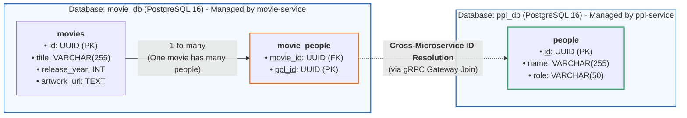

# Movie Hub

A microservices-based Movie Application built with Spring Boot (Kotlin), Svelte 5, gRPC, and PostgreSQL.

---

## 1. System Architecture

The application is built using a modern microservices architecture coordinated inside an isolated Docker network (`movie-network`):


### Architecture Breakdown
1. **Frontend (Svelte 5 SPA)**:
   - Built with **Svelte 5, Vite, and TypeScript** on port `5173`.
   - Communicates exclusively with the backend via **GraphQL over HTTP** (`:8081`).
2. **BFF Gateway (`movie-service`)**:
   - Built with **Spring Boot & Kotlin** on port `8081`.
   - Single public entry point that exposes the GraphQL API and handles movie business logic.
   - Connects to **The Movie Database (TMDb)** via REST/HTTPS for live movie discovery and poster resolution.
   - Communicates with `ppl-service` over fast internal **gRPC** (`:9090`).
3. **Internal Microservice (`ppl-service`)**:
   - Built with **Spring Boot & Kotlin** on port `9090`.
   - Dedicated private service (no public HTTP port) managing cast, crew, and talent.
   - Exposes gRPC endpoints with Protocol Buffers for sub-millisecond inter-service communication.
4. **Database (PostgreSQL 16)**:
   - Runs as a containerized database service on port `5432` with a persistent volume.
   - Houses two isolated databases (`movie_db` and `ppl_db`) accessed via JDBC.

---

## 2. Database Architecture & Data Model

The application follows the **Database-per-Service** pattern with two isolated PostgreSQL databases. Services maintain loose coupling with zero cross-database foreign keys.



### How Cross-Service Resolution Works
1. **Isolated Data Stores**: 
   - `movie_db` stores movies and associative records in `movie_people (movie_id, ppl_id)`.
   - `ppl_db` independently stores actors and directors in `people (id, name, role)`.
2. **No Database-Level Foreign Key**: `movie_people.ppl_id` stores UUIDs referencing `people.id`, but does **not** enforce a cross-database foreign key constraint.
3. **gRPC Join at Application Level**: When a client queries a movie with its cast or crew, `movie-service` fetches the movie, collects the associated `ppl_id` list, and calls `ppl-service` via high-performance internal **gRPC** (`GetPeopleByIds`) to resolve names and roles on-the-fly.

### Accessing Databases via Adminer
Manage both databases using the built-in [Adminer](http://localhost:8080) web interface:
- **URL**: [http://localhost:8080](http://localhost:8080)
- **System**: `PostgreSQL`
- **Server**: `postgres`
- **Username**: `postgres`
- **Password**: `postgresPassword`
- **Database**: `movie_db` *(movies)* or `ppl_db` *(people/cast)*

---

## 3. Quick Start with Docker

Once you have [Docker](https://www.docker.com/) installed and running, spin up the entire system (frontend, microservices, database, and adminer) with one command:

```bash
cd docker
docker compose up -d --build
```

To stop all services:
```bash
cd docker
docker compose down
```

> 📖 For detailed Docker commands, logging, and environment variable configurations, see the [Docker Guide](docker/README.md).

---

## 4. Accessing the Application

### Frontend Web App
Open your browser and navigate to:
- **URL**: [http://localhost:5173](http://localhost:5173)

Browse movie catalogs, view cast details resolved across microservices, and search live TMDb data.

---

### Backend API via Postman (GraphQL)
> **Key Note**: Only `movie-service` exposes an external GraphQL HTTP API (`:8081`). `ppl-service` is an internal private microservice that communicates exclusively over gRPC (`:9090`).

- **Endpoint**: `POST http://localhost:8081/graphql`
- **Postman Collection**: Import the ready-to-use file [`postman/Movie_Hub_movie-service.postman_collection.json`](postman/Movie_Hub_movie-service.postman_collection.json) into Postman.

#### Sample GraphQL Query
In Postman, create a `POST` request to `http://localhost:8081/graphql` with body:

```graphql
query GetAllMoviesWithPeople {
  movies {
    id
    title
    releaseYear
    artworkUrl
    people {
      id
      name
      role
    }
  }
}
```

---

## 5. Service Summary & Ports

| Service | Protocol / Type | Port / URL | Description |
|---|---|---|---|
| **Frontend** | HTTP | `http://localhost:5173` | Svelte 5 UI Dashboard |
| **Movie Service** | HTTP / GraphQL | `http://localhost:8081/graphql` | Public Gateway & BFF (GraphQL entry point) |
| **People Service** | gRPC | `localhost:9090` | Internal gRPC service (called by Movie Service) |
| **Adminer** | HTTP | `http://localhost:8080` | Web UI for PostgreSQL databases |
| **PostgreSQL** | TCP | `localhost:5432` | Databases: `movie_db` and `ppl_db` |
