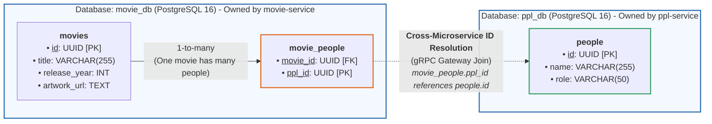

# Docker Environment Guide

This folder contains the Docker Compose setup to run the entire Movie Hub microservices platform locally with a single command.

---

## Database Schema & Entity Relationship

The platform uses two isolated databases running inside the `movie-postgres` container:



### Simple Explanation
1. **Isolated Databases**:
   - **`movie_db`**: Managed by `movie-service`. Contains `movies` and the junction table `movie_people`.
   - **`ppl_db`**: Managed by `ppl-service`. Contains `people` (actors, directors).
2. **Cross-Service ID Resolution**:
   - `movie_people.ppl_id` stores the UUID of a person, but there is **no database foreign key** across the two databases.
   - When a movie is queried with its people, `movie-service` fetches the IDs and calls `ppl-service` over **gRPC** (`GetPeopleByIds`) to resolve their names and roles.
   - This keeps the microservices loosely coupled and independently scalable.
3. **Database Management (Adminer)**:
   - Access at [http://localhost:8080](http://localhost:8080)
   - Server: `postgres` | User: `postgres` | Password: `postgresPassword`
   - Database: select `movie_db` or `ppl_db`

---

## Containers Overview

Docker Compose coordinates 5 containers on an isolated internal network (`movie-network`):

| Container Name | Service | Exposed Port | Purpose |
|---|---|---|---|
| `movie-postgres` | PostgreSQL 16 | `5432` | Houses isolated `movie_db` & `ppl_db` |
| `movie-adminer` | Adminer Web UI | `8080` | Web database management tool |
| `movie-ppl-service` | People Microservice | `9090` | Internal gRPC service for cast/crew |
| `movie-movie-service` | Movie Microservice | `8081` | Public GraphQL BFF & gRPC client |
| `movie-frontend` | Svelte 5 Web App | `5173` | Production Nginx serving UI |

---

## Prerequisites

- [Docker Desktop](https://www.docker.com/products/docker-desktop/) installed and running.

---

## Configuration (`.env`)

A default `.env` file is already provided in this directory. If creating a new one, copy from `.env.example`:

```bash
cp .env.example .env
```

Key environment variables:
- `POSTGRES_USER` / `POSTGRES_PASSWORD`: Database credentials (default: `postgres` / `postgresPassword`).
- `TMDB_READ_ACCESS_TOKEN`: TMDb API v4 Bearer Read Access Token for live movie searches and poster resolution.
- `FRONTEND_PORT`: Exposed port for the web dashboard (default: `5173`).
- `ADMINER_PORT`: Exposed port for Adminer DB manager (default: `8080`).

---

## Commands

### Start All Services
From this `docker/` directory:
```bash
docker compose up -d --build
```
> **Note**: The `--build` flag ensures latest local code changes are compiled into the container images.

### View Service Logs
```bash
# View logs from all services
docker compose logs -f

# View logs from a specific service
docker compose logs -f movie-service
docker compose logs -f ppl-service
docker compose logs -f frontend
```

### Stop All Services
```bash
docker compose down
```

### Reset Database & Volumes
If you need to wipe database data and re-run initial seed scripts:
```bash
docker compose down -v
docker compose up -d --build
```
*(The `-v` flag removes the persistent `movie_postgres_data` volume).*

---

## Database Initialization
When Postgres starts for the first time, scripts in [`../database/init-scripts`](../database/init-scripts) are executed automatically in alphabetical order:
1. `01-create-databases.sql`: Creates `movie_db` and `ppl_db`.
2. `02-schema.sql`: Creates `movies`, `movie_people`, and `people` tables.
3. `03-seed-data.sql`: Seeds initial movie and actor/director records.
