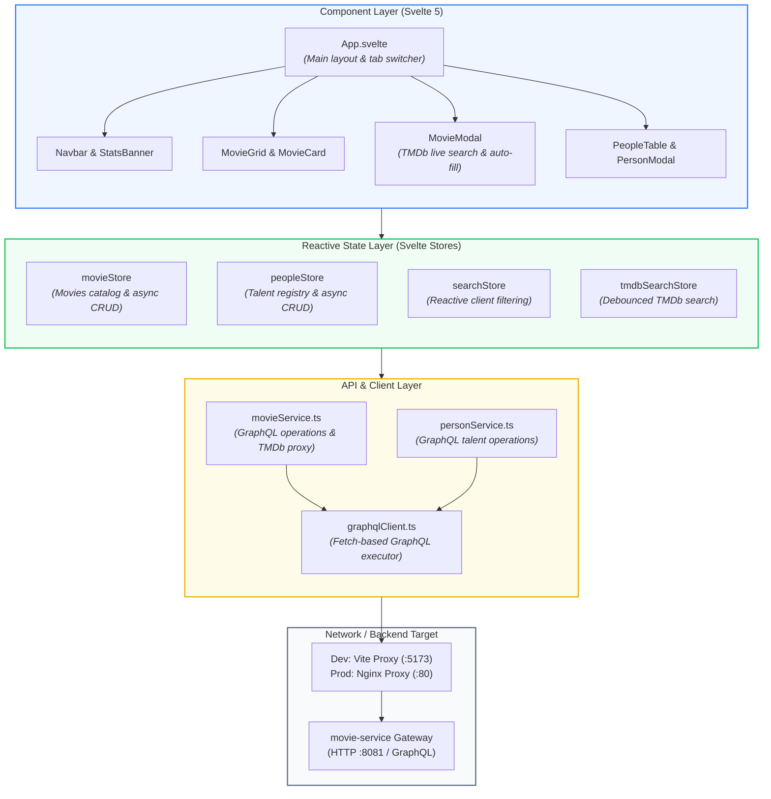

# Movie Hub - Frontend Web Application

Modern Single Page Application (SPA) built with **Svelte 5**, **TypeScript**, and **Vite** for the Movie Hub platform.

---

## 1. Local Development (Hot Reload + Docker Backend)

You can run the backend services in Docker while developing the frontend locally with instant **Hot Module Replacement (HMR)**.

### Step 1: Start Backend Services in Docker
Run only the database and backend microservices (omitting the frontend container):

```bash
cd docker
docker compose up -d postgres adminer ppl-service movie-service
```

*(If you previously ran `docker compose up -d`, simply stop the frontend container with `docker compose stop frontend`)*.

### Step 2: Run Frontend Locally with Hot Reload
In a separate terminal:

```bash
cd frontend
npm install
npm run dev
```

Open **[http://localhost:5173](http://localhost:5173)** in your browser. Any changes made to `.svelte` or `.ts` files will update instantly via Vite HMR.

---

## 2. Useful Commands

| Command | Description |
|---|---|
| `npm run dev` | Starts the Vite development server with HMR at `http://localhost:5173` |
| `npm run build` | Type-checks and builds optimized production bundle into `dist/` |
| `npm run preview` | Locally serves and previews the production `dist/` build |
| `npm run check` | Runs `svelte-check` and `tsc` to validate Svelte & TypeScript types |

---

## 3. Frontend Architecture

The frontend follows a clean layered architecture separating UI components, reactive state stores, and the API communication layer:



---

## 4. Architecture Explanation

### 1. Component Layer (`src/lib/components/`)
- **`movies/`**:
  - `MovieGrid.svelte` & `MovieCard.svelte`: Responsive movie cards displaying title, release year, artwork, and resolved cast members.
  - `MovieModal.svelte`: Intelligent creation modal. When typing a title, it queries TMDb in real-time and auto-populates title, year, high-res posters, and suggested cast—**no manual typing or file uploads needed**.
- **`people/`**:
  - `PeopleTable.svelte` & `PersonModal.svelte`: Table view and management of actors, directors, and creators.
- **`layout/` & `common/`**:
  - Reusable buttons, badges, modals, toast alerts, and navigation bar.

### 2. Reactive State Layer (`src/lib/stores/`)
- **`movieStore.ts` & `peopleStore.ts`**: Hold application data and provide actions (`load`, `addMovie`, `deleteMovie`, etc.) with loading/error states.
- **`searchStore.ts`**: Derived Svelte stores that filter movies and people instantly as the user types without making repeated network calls.
- **`tmdbSearchStore.ts`**: Handles debounced search requests to TMDb for smooth auto-suggestions.

### 3. API & Proxy Routing
- **`graphqlClient.ts`**: Lightweight, dependency-free GraphQL client using browser `fetch`.
- **API Proxying**:
  - **In Development**: `vite.config.ts` proxies requests from `/api/movies/*` and `/api/ppl/*` to `http://localhost:8081` to avoid CORS issues.
  - **In Production**: `nginx.conf` runs inside Docker on port `80` (mapped to `5173`), serving static assets and reverse-proxying API calls directly to `movie-service:8081`.
